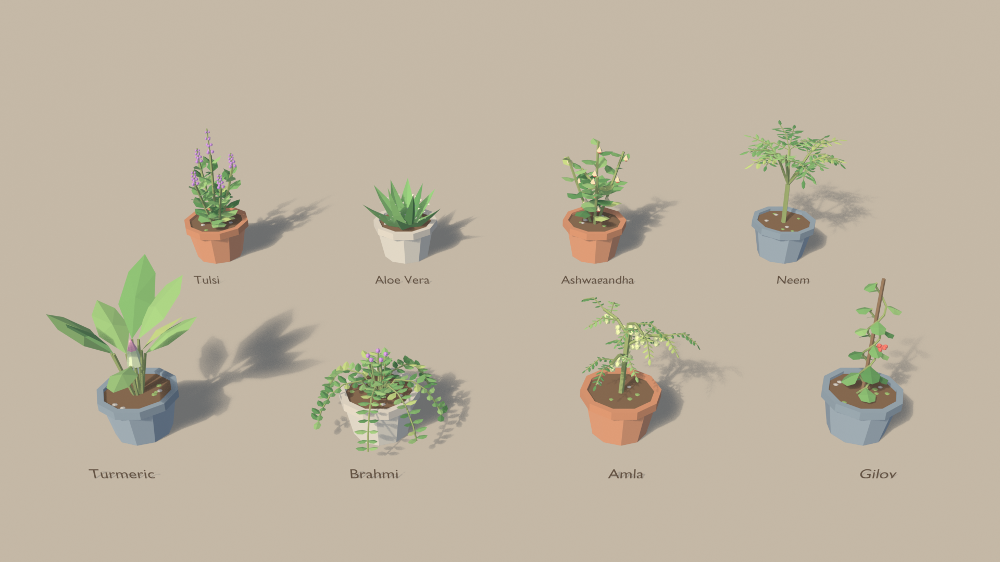

# Vatika

Vatika is a small 3D garden of Indian medicinal herbs that you walk around in and look after. You get your own garden when you sign up, with eight plants in it: Tulsi, Aloe Vera, Ashwagandha, Neem, Turmeric, Brahmi, Amla and Giloy. Each one gets thirsty on its own schedule. If you forget about them they start to droop and lean over, and when you water them they perk back up. Walk up to a plant and you can read about it: its botanical name, where it grows, which parts are used and what it has traditionally been used for.

"Vatika" means a small garden in Sanskrit and Hindi, which is what this is.

You can try it in two ways:

- **In the browser:** [vatika-garden.netlify.app](https://vatika-garden.netlify.app)
- **As a Mac app:** download `Vatika-0.1.0-arm64.dmg` from the [Releases page](https://github.com/GT-Snix/Vatika/releases)

Both use the same backend and the same accounts, so the garden you see on the website is the one you see in the app.



> The plant information is there for learning. It is not medical advice.

---

## Contents

- [How to play](#how-to-play)
- [The Mac app](#the-mac-app)
- [How it is built](#how-it-is-built)
- [Repository layout](#repository-layout)
- [The backend](#the-backend)
- [The frontend](#the-frontend)
- [The 3D models](#the-3d-models)
- [The desktop app](#the-desktop-app)
- [Deployment on Netlify](#deployment-on-netlify)
- [Running it locally](#running-it-locally)
- [Known limitations](#known-limitations)
- [License](#license)

---

## How to play

Create an account with an email and a password of at least eight characters. While signing up you pick how fast time runs in your garden:

| Setting   | Speed | What it means                                    |
|-----------|-------|--------------------------------------------------|
| Real time | 1x    | One real hour is one garden hour                 |
| Relaxed   | 4x    | One real hour is four garden hours               |
| Quick     | 60x   | One real minute is one garden hour               |
| Demo      | 600x  | One real minute is ten garden hours; a full day passes in about 2.4 minutes |

Real time is how it is meant to be played. Demo is there so you can see plants go from healthy to wilting without waiting a day or two. You can change the speed later from "Clock settings", but changing it resets every plant's timer.

Once you are in, click the screen to enter the garden. That captures the mouse so you can look around.

| Key       | What it does                                  |
|-----------|-----------------------------------------------|
| Click     | Enter the garden (captures the mouse)         |
| Mouse     | Look around                                   |
| W A S D   | Walk                                          |
| Shift     | Sprint                                        |
| Space     | Jump                                          |
| E         | Open the info panel for the plant you are facing |
| F         | Pour water on the plant you are facing        |
| Esc       | Let go of the mouse, or close a panel         |

You hold a watering can in your right hand. Press F while facing a plant and the can tilts toward it, water comes out of the spout, and a moment later the plant is watered. You can also water from the info panel with the Water button.

The sky follows the garden clock too. The sun rises around 6, is highest at noon and sets around 18, and at night the light turns into blue moonlight with stars overhead. The garden starts at your own local time of day.

---

## The Mac app

The release on GitHub is a macOS build for Apple Silicon (M1 or later).

1. Download `Vatika-0.1.0-arm64.dmg` from the [Releases page](https://github.com/GT-Snix/Vatika/releases).
2. Open it and drag Vatika into Applications.
3. The first time, right-click Vatika and choose Open, then click Open again. The app is not signed with an Apple developer certificate yet, so macOS asks you to confirm.
4. Log in or create an account.

It needs an internet connection, because your garden is stored on the server, not on your Mac.

---

## How it is built

There are four pieces, and they each live in their own folder:

```
                    +-------------------------------+
  Browser  -------> |  Netlify: vatika-garden site   |
                    |                               |
                    |  /        -> client/dist      |  (static React + three.js build)
                    |  /api/*   -> Netlify Function |  (the Express app from server/)
                    +---------------+---------------+
                                    |
  Mac app (Electron)                |  Prisma over the pg driver
  app://vatika/api/* --forwards-->  |
                                    v
                            +---------------+
                            |  Neon Postgres |
                            +---------------+
```

- **`server/`** is a Node.js and Express API. It handles sign-up and login, stores the plant encyclopedia and every user's garden in Postgres (hosted on Neon), and works out how healthy each plant is.
- **`client/`** is a React app built with Vite. The garden itself is drawn with three.js through React Three Fiber.
- **`models-src/`** holds Python scripts that run inside Blender and generate every 3D model from code. Their output, `.glb` files, goes into `client/public/models/`.
- **`desktop/`** wraps the built client in an Electron window for the Mac app.

The main stack:

| Part      | What is used                                                            |
|-----------|-------------------------------------------------------------------------|
| Frontend  | React 19, Vite 8, three.js, @react-three/fiber, @react-three/drei       |
| Backend   | Node.js 22.18+, Express 5, Prisma 7 with the `pg` adapter, bcryptjs, jsonwebtoken |
| Database  | PostgreSQL on Neon                                                      |
| Hosting   | Netlify (static site plus one Netlify Function for the API)             |
| Desktop   | Electron 45, electron-builder                                           |
| Models    | Blender, driven by Python scripts                                       |

---

## Repository layout

```
Vatika/
  client/                 React front end
    public/models/        the .glb plant and player models
    src/
      api.js              the only file that talks to the server
      useGarden.js        garden state, polling and actions
      App.jsx             top-level screen logic
      auth/               login and sign-up form
      scene/              everything 3D
      ui/                 HUD, info panel, clock dialog
    netlify.toml          Netlify build, functions and redirect config

  server/                 Express API
    app.js                the Express app (no listening)
    index.js              local entry point, listens on PORT
    netlify/api.mjs       Netlify Function entry point
    routes/               /auth, /plants, /garden
    middleware/auth.js    JWT check
    lib/
      health.js           the plant health formula
      health.test.js      tests for it
      clock.js            the allowed clock speeds
      db.js               the shared Prisma client
      env.js              loads .env.local and .env
    prisma/
      schema.prisma       data model
      migrations/         SQL migrations
      seed.js             the eight plants

  models-src/             Blender scripts that generate the models
  desktop/                Electron shell for the Mac app
```

---

## The backend

### Data model

There are three tables, defined in `server/prisma/schema.prisma`:

- **User** has an email (unique, stored lowercased and trimmed), a bcrypt password hash, and `timeScale`, which is their garden clock speed.
- **Plant** is the shared encyclopedia, one row per species: name, botanical name, habitat, parts used, uses, and `waterIntervalHours`. Every user sees the same Plant rows.
- **UserPlant** is a user's own copy of a plant. The only thing it really stores is `lastWateredAt`. There is a unique constraint on `(userId, plantId)` so nobody can own the same plant twice, and rows are deleted along with their user or plant.

Keeping it this way means the descriptive text lives in one place, and the only per-user state is a single timestamp per plant.

`prisma/seed.js` fills in the eight plants. It upserts by name, so you can run it again safely and it will update the rows rather than duplicate them. The watering intervals range from 12 hours for Brahmi (a wetland plant) to 96 hours for Amla. They are tuned for the game, not real gardening advice.

### How health works

Health is never stored. It is calculated every time from when the plant was last watered, which lives in `server/lib/health.js`:

```
hours since watering (in game hours) = real hours since watering * timeScale
health = 100 * (1 - game hours / (2 * waterIntervalHours))
```

The result is clamped between 0 and 100 and rounded. So a plant is at 100 right after watering, at 50 after one watering interval, and at 0 after two. The status comes from the number:

- above 66 is **healthy**
- above 33 is **thirsty**
- otherwise it is **wilting**

There is a second function, `secondsUntil`, that solves the same formula backwards to find how many real seconds are left until the plant turns thirsty or wilting. The server sends those two numbers with every plant, so the client can show a countdown without knowing the formula. Because health is rounded before being compared to the thresholds, the status really changes when the unrounded value drops below 66.5 or 33.5, and `secondsUntil` accounts for that so the countdown and the status never disagree.

Both functions take "now" as a parameter instead of reading the clock themselves, which makes them easy to test. `npm test` in `server/` runs `lib/health.test.js`, which uses Node's built-in `assert` and checks ten cases, including one that confirms that one second before the predicted moment the status has not changed yet, and at the predicted moment it has.

### API

All responses are JSON. Routes marked "login" need an `Authorization: Bearer <token>` header.

| Method | Path                       | Auth  | What it does |
|--------|----------------------------|-------|--------------|
| POST   | `/auth/register`           | none  | Create an account. Body: `{ email, password, timeScale? }`. Also creates the user's garden with all eight plants freshly watered, in one transaction. |
| POST   | `/auth/login`              | none  | Body: `{ email, password }`. Returns `{ token }`, a JWT valid for 7 days. |
| GET    | `/auth/me`                 | login | Returns `{ id, email }`. |
| GET    | `/plants`                  | none  | The whole encyclopedia. |
| GET    | `/plants/:id`              | none  | One plant. |
| GET    | `/garden`                  | login | `{ timeScale, speeds, plants }`, where each plant has its info plus `health`, `status`, `lastWateredAt`, `secondsUntilThirsty` and `secondsUntilWilting`. |
| POST   | `/garden/:plantId/water`   | login | Waters one plant and returns it with fresh health. |
| POST   | `/garden/clock`            | login | Body: `{ timeScale }`. Changes the clock speed, resets every plant's timer, and returns the whole garden. |

On the hosted site these are all under `/api`, for example `https://vatika-garden.netlify.app/api/plants`.

A few decisions worth pointing out:

- **The server decides the time.** When you water a plant, the client does not send a timestamp or a user id. The user id comes from the verified token and the time comes from the server's own clock, so nobody can water a plant "in the past" or water someone else's garden.
- **Login errors do not reveal which emails exist.** A wrong email and a wrong password get the same "Invalid email or password" message.
- **Passwords are hashed with bcrypt** at cost 10, and the hash is never sent back. Responses pick their fields by hand so it cannot leak by accident.
- **Clock speeds are checked strictly.** `lib/clock.js` holds the one list of allowed speeds (1, 4, 60, 600). The check uses `===`, so the string `"60"` is rejected; it has to be a number.
- **Errors are handled in one place.** Express 5 forwards errors from async handlers to a single error middleware at the end of `app.js`. It logs the real error after passing it through `keyblob`'s `redact()`, which masks passwords, tokens and database credentials, and the client only gets a generic message.
- **The server refuses to start without `JWT_SECRET`,** both locally and on Netlify, rather than starting and crashing on the first login. It also exits with a clear message if the port is already taken.

### Database connection

`lib/db.js` creates one shared Prisma client for the whole app, using the `@prisma/adapter-pg` adapter with the `pg` driver. Prisma 7 generates its client into `server/generated/prisma` as TypeScript, and the server imports it directly. That works because Node 22.18 and later can run TypeScript files by stripping the types, which is why the server needs at least that version.

There are two connection strings from Neon:

- `DATABASE_URL` is the pooled connection, used by the running server.
- `DATABASE_URL_UNPOOLED` is the direct connection, used by `prisma migrate`, which does not work through the pooler. This is set in `prisma.config.js`.

`lib/env.js` loads `.env.local` first (where `neon env pull` writes the Neon values) and then `.env` (for `JWT_SECRET`, `PORT` and so on). dotenv never overwrites a value that is already set, so real environment variables, like the ones on Netlify, always win.

### One app, two entry points

`app.js` builds the Express app but never calls `listen`. Two files use it:

- `index.js` is for local development. It calls `app.listen` on port 4000.
- `netlify/api.mjs` wraps the same app with `serverless-http` and exports it as a Netlify Function handler.

On Netlify, a request to `/api/garden` is rewritten to `/.netlify/functions/api/garden`. A small middleware in `app.js` strips either prefix off the URL, so the routes themselves are just `/plants`, `/auth` and `/garden` everywhere.

---

## The frontend

### Talking to the server

`client/src/api.js` is the only file that calls `fetch`. It adds the JSON headers and the token, turns network failures into a readable message, and handles one special case: if a request that carried a token comes back with 401, the token has expired or is invalid, so it clears it and sends the user back to the login screen. A 401 from the login form itself just means a wrong password and is shown as an error.

The token is kept in `localStorage`, wrapped in try/catch so that private browsing or blocked storage does not break anything. At worst you stay logged in only until the tab closes.

The API address comes from `VITE_API_URL`. In development it is `http://localhost:4000`. In the production build it is just `/api`, because the page and the API are on the same domain.

### Keeping the garden in sync

`client/src/useGarden.js` is a plain React hook that holds the garden and its actions. The server is always the source of truth, and the hook keeps up with it in three ways:

1. It fetches `/garden` when you log in and again every 15 seconds.
2. Each plant is stamped with the moment its countdowns were received. The UI then counts down locally, once a second, from those numbers.
3. When the soonest countdown is about to hit zero, it schedules a fetch for that moment plus 300 ms, so the plant's status changes on screen right when it changes on the server.

When you water a plant, the hook shows the server's response for that plant straight away and then re-fetches the whole garden in the background.

### Screens and UI

- `auth/AuthScreen.jsx` is a single form for both login and sign-up. Signing up creates the account and then logs in straight away.
- `ui/Hud.jsx` shows the clock speed, the current garden time, the clock settings and log out buttons, and while you are walking, a crosshair and a hint with the name of the plant in front of you.
- `ui/Panel.jsx` is the info panel: name, botanical name, status, a live countdown, a health bar, habitat, parts used and uses, and a Water button.
- `ui/ClockModal.jsx` lets you change the clock speed. The list of speeds comes from the server, so the client never hardcodes which ones exist (apart from the sign-up form, which has to show them before you are logged in).
- `ui/useDialog.js` is the shared keyboard handling for the panel and the modal. When a dialog opens, focus goes to the dialog itself rather than a button. That way, if you were jumping with Space as the panel opened, the Space press cannot accidentally press Water. Esc closes, and Tab cycles inside the dialog instead of escaping to the page behind it.

Fonts (Fraunces for headings, Inter for body text) are bundled from npm instead of loaded from Google, so nothing extra is fetched from outside.

### The 3D garden

Everything 3D is in `client/src/scene/`.

**Layout (`layout.js`).** This is the one file that decides where each plant stands. The player starts at the centre facing forward, and the eight plants sit on stone plinths along an arc 4.8 m away, spread from 100 degrees left to 100 degrees right. The order is chosen so neighbours contrast: tall next to wide, and no two neighbouring pots the same colour. Every plant uses the same scale so all the pots match and the plants keep their natural height differences; the plinths make up the difference, so short plants get tall plinths and the tops of all plants end up between 1.45 m and 1.65 m. Each plant gets a small random turn so the row does not look machine-placed, but the random numbers come from a seeded generator (mulberry32), so the garden looks the same on every load. The file also checks itself: if a layout change leaves too little room to walk between two plants, it throws an error instead of quietly creating a gap you can get stuck in.

**Plants (`PlantModel.jsx`, `Plinth.jsx`).** Each plant loads its `.glb` file. The model is cloned per plant, including its materials, so tinting one plant does not tint the others. Every model has separate `pot` and `plant` nodes, and only the `plant` part reacts to health: a thirsty plant leans forward about 4 degrees, droops slightly and takes on a warm yellow tint, and a wilting plant leans about 10 degrees, droops a bit more and turns a dry brownish yellow. The pot stays upright on the plinth. Changes ease in over time instead of snapping. Right after watering, the plant swells by about 12% for 0.6 seconds and settles back. If a model fails to load, an error boundary shows a simple stand-in pot and bush instead of blanking the whole scene, and logs the exact URL that failed.

**Walking (`Player.jsx`).** Mouse look uses drei's `PointerLockControls`. Walking speed is 3 m/s, multiplied by 1.6 when sprinting, and a jump peaks at 0.9 m. Collision is done in 2D: you cannot walk more than 11 m from the centre, and each plinth has a circle around it that pushes you back out. The circle grows if a plant's leaves spread wider than its plinth, so you cannot walk into the middle of a bush. Frame time is capped at 0.1 s, which keeps each step far smaller than the smallest collision circle, so even a slow frame cannot carry you through a plinth. There is a gentle head bob, two bumps per step cycle.

**Targeting (`Targeting.jsx`).** To work out which plant you are facing, it does not use raycasting. Thin leaves are hard to hit with a ray and it costs more per frame. Instead it checks two things on the ground plane: is the plant close enough, and is it close enough to straight ahead. It only tells React when the target actually changes.

**Hands, can and boots (`PlayerBody.jsx`, `TwoPassRender.jsx`, `Droplets.jsx`).** You can see your gloved hands, the watering can and your boots. The hands sway as you walk, drop lower when you sprint, and rise when you pour. Pressing F starts a pour: the can turns toward the plant, and 1.2 seconds in, that plant gets watered, even if you look away halfway through. The hands and can are drawn in a second render pass with the depth buffer cleared first, so they always appear on top and never poke into a plant when you stand close. The water is 60 droplets in one instanced mesh, so they cost a single draw call. Nothing is allocated per frame; finished droplets are just shrunk to zero until their slot is reused.

**Sky (`SkyLighting.jsx`, `useSkyTime.js`, `palette.js`).** The time of day comes from an anchor (a real moment, a game hour and a speed), so the hour can be worked out exactly on any frame without a ticking counter that would drift. When you change the speed, it re-anchors at the current hour so the sun does not jump. The sky colours, sun colour and strength, fog and star visibility are keyframes at certain hours that blend smoothly between each other. The sun rises in the east, peaks at noon and sets in the west, and its path is angled so the plants, which face the centre, are lit from the front. Below the horizon the moon takes over as the light source. The 100 stars are placed once from a fixed seed. The shadow area is a fixed box around the garden so shadows stay sharp all day.

**Debug mode.** Add `?debug` to the URL, for example `https://vatika-garden.netlify.app/?debug`, to see an FPS meter, a draw call count, which models loaded, and a slider to change the time of day.

---

## The 3D models

None of the models were made by hand in a 3D editor. Each one is a Python script in `models-src/` that runs inside Blender with no window and builds the plant from code: stems, leaves, flowers, fruit, pot and soil.

- `lib.py` has the shared pieces: one colour palette for all the plants so they look like a set, the pot (three glazes: terracotta, glazed blue and stone), soil and pebbles, leaf shapes, and the export code.
- `tulsi.py`, `aloe_vera.py`, `ashwagandha.py`, `neem.py`, `turmeric.py`, `brahmi.py`, `amla.py` and `giloy.py` each build one plant. For example, Tulsi has opposite leaf pairs that turn 90 degrees from the pair below, the way basil actually grows, with a purple flower spike on each stem.
- `player.py` builds the gloves, sleeves, watering can and boots.
- `contact_sheet.py` imports all eight exported files and renders them side by side, which is the image at the top of this README. Because it loads the exported `.glb` files, it also checks that the exports actually work.

A few rules every model follows:

- Colours are vertex colours on one mesh with one material, so each plant is a single draw call in the browser.
- Each plant has a budget of 5,000 triangles, and the export fails if it goes over.
- Randomness is seeded from the plant's name, so running a script again gives exactly the same model.
- Stems start 1 cm below the soil surface so their ends never sit in the same plane as the soil, which would cause flickering.
- The pot and the plant are exported as separate nodes, with the plant's origin at the centre of the soil. That is what lets the game tilt and droop just the plant, pivoting exactly where the stems come out.

To rebuild a model, run it from the repository root (the path below is the default macOS install):

```bash
/Applications/Blender.app/Contents/MacOS/Blender --background --factory-startup \
    --python models-src/tulsi.py
```

That writes `client/public/models/tulsi.glb` and a preview image in `models-src/previews/`.

---

## The desktop app

The Mac app is in `desktop/` and is a thin Electron shell around the same React build the website uses.

Electron was chosen over Tauri for one specific reason. The garden needs pointer lock for mouse look, and the macOS web view that Tauri uses (WKWebView) does not allow pointer lock inside apps. Electron ships its own Chromium, where it works the same as in Chrome.

`desktop/main.js` registers a private `app://vatika` protocol and serves the built client from it. Any request to `app://vatika/api/...` is forwarded to `https://vatika-garden.netlify.app/api/...`. From the page's point of view, the files and the API come from the same origin, exactly like on the website, so the client code does not change at all and the server does not need any CORS changes. Paths are normalised and checked so a request cannot read files outside the app's own folder, and unknown paths fall back to `index.html`.

To build it:

```bash
cd desktop
npm install
npm start      # builds the client, copies it into desktop/client, and opens it in Electron
npm run app    # same, then packages Vatika.app with electron-builder
```

`npm run app` produces an unpacked `.app` in `desktop/dist/`. The DMG on the Releases page was made with electron-builder from the same setup (`npx electron-builder --mac dmg`).

---

## Deployment on Netlify

The hosted version at [vatika-garden.netlify.app](https://vatika-garden.netlify.app) is a single Netlify site that serves both the frontend and the API. The config is in `client/netlify.toml`:

- The built client in `client/dist` is published as the static site.
- The functions folder points at `../server/netlify-dist`, which holds the bundled API.
- A redirect sends `/api/*` to `/.netlify/functions/api/:splat` with status 200, so it is a rewrite, not a visible redirect.

Because the page and the API share one domain, CORS never comes into play in production.

The API is bundled ahead of time with esbuild (`npm run build:function` in `server/`) into one file, `netlify-dist/api.cjs`, and Netlify is told to ship it as it is (`node_bundler = "nft"`) instead of bundling it again. The reason for doing this by hand is that Netlify's own bundling step broke `import.meta`, which `lib/env.js` and the generated Prisma client both rely on. The build script replaces `import.meta.url` and `import.meta.dirname` with CommonJS equivalents while bundling.

The site needs two environment variables set in Netlify:

- `DATABASE_URL`, the Neon pooled connection string
- `JWT_SECRET`, a long random string

The site is deployed by hand from the `client/` folder:

```bash
cd client
(cd ../server && npm run build:function) && npm run build && netlify deploy --prod --no-build
```

---

## Running it locally

You need Node.js 22.18 or newer and a Postgres database. The project uses Neon, but any Postgres works as long as you provide both connection strings.

### 1. Server

```bash
cd server
npm install
cp .env.example .env
```

Fill in `.env`:

```
JWT_SECRET=some-long-random-string
PORT=4000
CLIENT_ORIGIN=http://localhost:5173
```

Then add the database connection strings to `.env.local`. With the Neon CLI, `neon env pull` writes them for you. Otherwise add them yourself:

```
DATABASE_URL=postgresql://...        # pooled, used by the server
DATABASE_URL_UNPOOLED=postgresql://... # direct, used by migrations
```

Generate the Prisma client, create the tables, add the plants, and start the server:

```bash
npx prisma generate
npm run migrate
npm run seed
npm run dev
```

The API is now on `http://localhost:4000`. Run `npm test` to check the health formula.

### 2. Client

In another terminal:

```bash
cd client
npm install
cp .env.example .env
npm run dev
```

Open `http://localhost:5173`. The dev server always uses port 5173, because that is the origin the server allows through CORS. If something else is using the port, Vite stops with an error instead of quietly picking another one.

### Useful commands

| Where     | Command                  | What it does                                  |
|-----------|--------------------------|-----------------------------------------------|
| `server/` | `npm run dev`            | Run the API and restart on changes            |
| `server/` | `npm test`               | Run the health formula tests                  |
| `server/` | `npm run migrate`        | Apply Prisma migrations                       |
| `server/` | `npm run seed`           | Insert or update the eight plants             |
| `server/` | `npm run build:function` | Bundle the API for Netlify                    |
| `client/` | `npm run dev`            | Run the Vite dev server                       |
| `client/` | `npm run build`          | Build the static site into `dist/`            |
| `desktop/`| `npm start`              | Build the client and open it in Electron      |
| `desktop/`| `npm run app`            | Package the Mac app                           |

---

## Known limitations

- The Mac build is Apple Silicon only. There is no Intel or Windows build yet.
- The Mac app is not signed, so the first launch needs the right-click and Open step.
- Both the website and the app need an internet connection, since the garden is saved on the server.
- The garden is designed for a keyboard and mouse. It does not have touch controls, so it is not really playable on a phone.
- Watering intervals are game values, not real care instructions, and the plant descriptions are for learning only, not medical advice.

---

## License

Vatika is released under the [MIT License](LICENSE).
